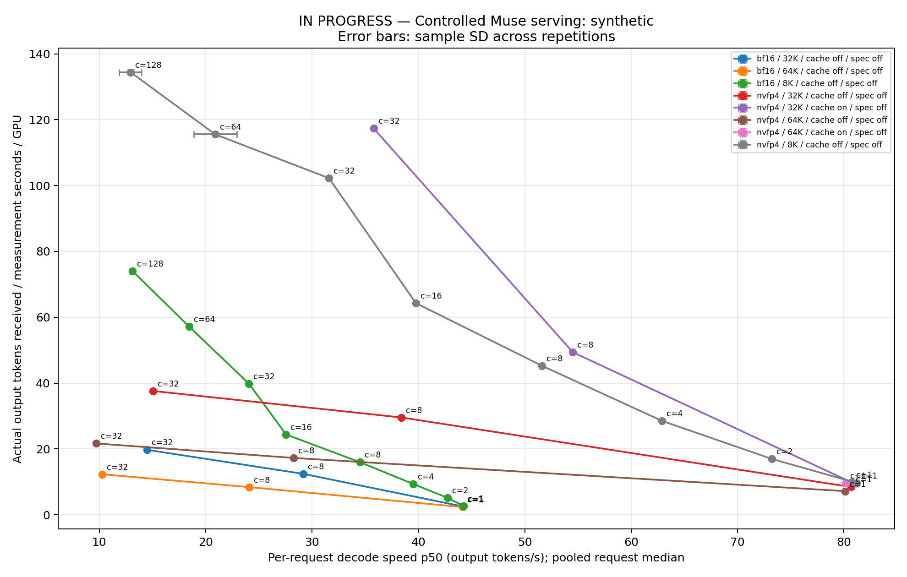

# Muse 受控压测完整协议进度

以下结果为进行中的测量；完整曲线、长上下文与投机对照尚未全部完成。

更新时间：2026-10-28 22:22:42 UTC。

配置、模型完整 revision、镜像 digest、实际启动命令、物理 GPU 与 native server_info：[reproducibility.json](reproducibility.json)。

已完成规定重复的测点如下。TTFT/E2E 单位为秒，TPOT 为毫秒/token；输出速度包含 reasoning 与回答。吞吐按实际测量窗计算。

| 模型/输入 | 缓存/投机 | 并发 | 重复 | 测量秒数合计 | 成功/失败入场请求 | 输出 t/s/GPU ±重复SD | 单请求 t/s p50 ±重复SD | TTFT p50/p95 | TPOT p50/p95 | E2E p50/p95 |
|---|---|---:|---:|---:|---:|---:|---:|---:|---:|---:|
| bf16/32768 | False/off | 1 | 3 | 2489.322 | 99/0 | 2.545 ± 0.002 | 44.184 ± 0.034 | 1.998/2.004 | 22.632/22.644 | 25.150/25.166 |
| bf16/32768 | False/off | 8 | 3 | 617.147 | 120/0 | 12.442 ± 0.011 | 29.197 ± 0.035 | 9.185/15.861 | 34.270/41.021 | 44.259/44.409 |
| bf16/32768 | False/off | 32 | 3 | 622.057 | 192/0 | 19.754 ± 0.013 | 14.492 ± 0.006 | 33.006/61.690 | 69.016/96.987 | 103.686/103.851 |
| bf16/65536 | False/off | 1 | 3 | 2694.465 | 99/0 | 2.351 ± 0.000 | 44.166 ± 0.001 | 4.044/4.057 | 22.642/22.675 | 27.208/27.242 |
| bf16/65536 | False/off | 8 | 3 | 913.462 | 120/0 | 8.408 ± 0.012 | 24.114 ± 0.009 | 18.387/32.228 | 41.555/55.302 | 60.933/61.037 |
| bf16/65536 | False/off | 32 | 3 | 997.777 | 192/0 | 12.315 ± 0.012 | 10.289 ± 0.008 | 66.846/125.002 | 97.229/154.228 | 166.447/166.645 |
| bf16/8192 | False/off | 1 | 3 | 2338.190 | 99/0 | 2.709 ± 0.002 | 44.242 ± 0.035 | 0.510/0.513 | 22.603/22.637 | 23.633/23.667 |
| bf16/8192 | False/off | 2 | 3 | 1234.382 | 102/0 | 5.165 ± 0.000 | 42.737 ± 0.023 | 0.873/0.991 | 23.399/23.523 | 24.803/24.844 |
| bf16/8192 | False/off | 4 | 3 | 724.805 | 108/0 | 9.402 ± 0.006 | 39.496 ± 0.056 | 1.484/1.960 | 25.320/26.052 | 27.388/27.442 |
| bf16/8192 | False/off | 8 | 3 | 398.450 | 120/0 | 15.984 ± 0.019 | 34.516 ± 0.042 | 2.467/3.928 | 28.973/30.626 | 32.098/32.261 |
| bf16/8192 | False/off | 16 | 3 | 360.253 | 144/0 | 24.402 ± 0.055 | 27.562 ± 0.081 | 4.429/7.835 | 36.282/39.702 | 41.584/41.770 |
| bf16/8192 | False/off | 32 | 3 | 360.416 | 192/0 | 39.856 ± 0.016 | 24.069 ± 0.050 | 8.386/15.464 | 41.548/48.345 | 50.957/51.139 |
| bf16/8192 | False/off | 64 | 3 | 429.832 | 384/0 | 57.176 ± 0.064 | 18.442 ± 0.016 | 15.937/30.036 | 54.223/67.772 | 71.569/71.860 |
| bf16/8192 | False/off | 128 | 3 | 663.986 | 747/0 | 74.040 ± 0.205 | 13.134 ± 0.116 | 30.008/57.917 | 76.140/103.228 | 109.599/111.177 |
| nvfp4/native-0-8192 | False/off | 1 | 3 | 1227.130 | 99/0 | 10.104 ± 0.002 | 81.690 ± 0.008 | 0.107/0.263 | 12.241/12.299 | 12.632/12.844 |
| nvfp4/native-0-8192 | False/off | 8 | 3 | 360.366 | 144/0 | 53.812 ± 0.061 | 55.904 ± 0.103 | 0.727/0.824 | 17.888/18.170 | 19.027/19.289 |
| nvfp4/native-0-8192 | False/off | 32 | 3 | 360.225 | 384/0 | 151.826 ± 0.356 | 40.637 ± 0.106 | 2.053/2.747 | 24.608/25.892 | 27.270/27.428 |
| nvfp4/native-8192-32768 | False/off | 1 | 3 | 1324.546 | 99/0 | 9.456 ± 0.001 | 80.993 ± 0.012 | 0.844/0.984 | 12.347/12.357 | 13.491/13.623 |
| nvfp4/native-8192-32768 | False/off | 8 | 3 | 360.260 | 120/0 | 41.454 ± 0.007 | 49.602 ± 0.033 | 4.592/7.112 | 20.163/23.207 | 25.242/25.294 |
| nvfp4/native-8192-32768 | False/off | 32 | 3 | 360.359 | 192/0 | 68.217 ± 0.037 | 27.559 ± 0.029 | 15.161/28.125 | 36.293/48.460 | 52.382/52.539 |
| nvfp4/32768 | False/off | 1 | 3 | 1498.857 | 99/0 | 8.454 ± 0.000 | 80.681 ± 0.001 | 2.461/2.473 | 12.395/12.399 | 15.141/15.154 |
| nvfp4/32768 | False/off | 8 | 3 | 506.660 | 120/0 | 29.578 ± 0.021 | 38.387 ± 0.007 | 11.401/19.672 | 26.100/34.472 | 38.124/38.206 |
| nvfp4/32768 | False/off | 32 | 3 | 653.449 | 192/0 | 37.610 ± 0.009 | 15.073 ± 0.010 | 40.963/76.706 | 66.361/101.115 | 108.961/109.145 |
| nvfp4/32768 | True/off | 1 | 3 | 1260.660 | 99/0 | 9.865 ± 0.004 | 80.713 ± 0.004 | 0.292/0.294 | 12.390/12.394 | 12.967/12.975 |
| nvfp4/32768 | True/off | 8 | 3 | 360.410 | 144/0 | 49.397 ± 0.080 | 54.514 ± 0.111 | 1.853/2.083 | 18.344/19.470 | 20.636/20.759 |
| nvfp4/32768 | True/off | 32 | 3 | 360.433 | 384/0 | 117.370 ± 0.146 | 35.793 ± 0.051 | 4.830/8.100 | 27.940/31.303 | 33.552/33.746 |
| nvfp4/65536 | False/off | 1 | 3 | 1761.552 | 99/0 | 7.194 ± 0.000 | 80.131 ± 0.001 | 5.040/5.065 | 12.479/12.483 | 17.808/17.831 |
| nvfp4/65536 | False/off | 8 | 3 | 889.284 | 120/0 | 17.272 ± 0.004 | 28.292 ± 0.013 | 22.987/40.321 | 35.505/52.690 | 59.364/59.465 |
| nvfp4/65536 | False/off | 32 | 3 | 1133.590 | 192/0 | 21.680 ± 0.013 | 9.726 ± 0.003 | 83.638/156.426 | 102.875/174.197 | 188.982/189.159 |
| nvfp4/65536 | True/off | 1 | 3 | 1300.086 | 99/0 | 9.605 ± 0.000 | 80.153 ± 0.002 | 0.560/0.562 | 12.476/12.490 | 13.323/13.336 |
| nvfp4/8192 | False/off | 1 | 3 | 1287.300 | 99/0 | 9.690 ± 0.003 | 81.188 ± 0.008 | 0.610/0.613 | 12.317/12.321 | 13.211/13.215 |
| nvfp4/8192 | False/off | 2 | 3 | 723.959 | 102/0 | 16.987 ± 0.011 | 73.219 ± 0.031 | 1.084/1.213 | 13.658/13.802 | 15.052/15.079 |
| nvfp4/8192 | False/off | 4 | 5 | 788.285 | 180/0 | 28.549 ± 0.021 | 62.894 ± 0.071 | 1.859/2.413 | 15.903/16.781 | 18.125/18.165 |
| nvfp4/8192 | False/off | 8 | 5 | 600.501 | 200/0 | 45.242 ± 0.047 | 51.634 ± 0.067 | 3.072/4.837 | 19.370/21.416 | 22.906/22.963 |
| nvfp4/8192 | False/off | 16 | 3 | 360.488 | 192/0 | 64.296 ± 0.130 | 39.768 ± 0.061 | 5.493/9.664 | 25.148/29.487 | 31.268/31.360 |
| nvfp4/8192 | False/off | 32 | 3 | 360.492 | 288/0 | 102.246 ± 0.072 | 31.594 ± 0.035 | 10.373/19.125 | 31.652/40.199 | 42.896/43.028 |
| nvfp4/8192 | False/off | 64 | 3 | 425.420 | 353/0 | 115.538 ± 0.070 | 20.907 ± 2.033 | 18.298/37.054 | 47.830/66.455 | 70.921/71.200 |
| nvfp4/8192 | False/off | 128 | 3 | 731.265 | 698/0 | 134.439 ± 0.714 | 12.939 ± 1.054 | 30.995/69.050 | 77.284/113.133 | 121.370/122.869 |

当前吞吐—单用户速度曲线（仅含已验收测点）：

coding+review 各 native 输入长度桶及投机开关分别成线：[coding.png](coding.png)。

已完成 38 / 59 个当前列出的目标测点。真实 coding 输入分桶在准备后展开；自适应扩展另见 SATURATION/EXTENSION 记录。

| 模型 | 输入/工作负载 | 缓存 | 投机 | 并发 | 有效重复/目标 | 状态 |
|---|---|---|---|---:|---:|---|
| nvfp4 | synthetic/8192 | False | off | 1 | 3/3 | complete |
| nvfp4 | synthetic/8192 | False | off | 2 | 3/3 | complete |
| nvfp4 | synthetic/8192 | False | off | 4 | 5/5 | complete |
| nvfp4 | synthetic/8192 | False | off | 8 | 5/5 | complete |
| nvfp4 | synthetic/8192 | False | off | 16 | 3/3 | complete |
| nvfp4 | synthetic/8192 | False | off | 32 | 3/3 | complete |
| nvfp4 | synthetic/8192 | False | off | 64 | 3/3 | complete |
| nvfp4 | synthetic/8192 | False | off | 128 | 3/3 | complete |
| nvfp4 | synthetic/32768 | False | off | 1 | 3/3 | complete |
| nvfp4 | synthetic/32768 | False | off | 8 | 3/3 | complete |
| nvfp4 | synthetic/32768 | False | off | 32 | 3/3 | complete |
| nvfp4 | synthetic/32768 | True | off | 1 | 3/3 | complete |
| nvfp4 | synthetic/32768 | True | off | 8 | 3/3 | complete |
| nvfp4 | synthetic/32768 | True | off | 32 | 3/3 | complete |
| nvfp4 | synthetic/65536 | False | off | 1 | 3/3 | complete |
| nvfp4 | synthetic/65536 | False | off | 8 | 3/3 | complete |
| nvfp4 | synthetic/65536 | False | off | 32 | 3/3 | complete |
| nvfp4 | synthetic/65536 | True | off | 1 | 3/3 | complete |
| nvfp4 | synthetic/65536 | True | off | 8 | 1/3 | partial |
| nvfp4 | synthetic/65536 | True | off | 32 | 0/3 | pending |
| nvfp4 | coding/native-0-8192 | False | off | 1 | 3/3 | complete |
| nvfp4 | coding/native-0-8192 | False | off | 8 | 3/3 | complete |
| nvfp4 | coding/native-0-8192 | False | off | 32 | 3/3 | complete |
| nvfp4 | coding/native-8192-32768 | False | off | 1 | 3/3 | complete |
| nvfp4 | coding/native-8192-32768 | False | off | 8 | 3/3 | complete |
| nvfp4 | coding/native-8192-32768 | False | off | 32 | 3/3 | complete |
| nvfp4 | coding/native-input-bins-pending | False | NGRAM | 1 | 0/3 | pending |
| nvfp4 | coding/native-input-bins-pending | False | NGRAM | 8 | 0/3 | pending |
| nvfp4 | coding/native-input-bins-pending | False | NGRAM | 32 | 0/3 | pending |
| bf16 | synthetic/8192 | False | off | 1 | 3/3 | complete |
| bf16 | synthetic/8192 | False | off | 2 | 3/3 | complete |
| bf16 | synthetic/8192 | False | off | 4 | 3/3 | complete |
| bf16 | synthetic/8192 | False | off | 8 | 3/3 | complete |
| bf16 | synthetic/8192 | False | off | 16 | 3/3 | complete |
| bf16 | synthetic/8192 | False | off | 32 | 3/3 | complete |
| bf16 | synthetic/8192 | False | off | 64 | 3/3 | complete |
| bf16 | synthetic/8192 | False | off | 128 | 3/3 | complete |
| bf16 | synthetic/32768 | False | off | 1 | 3/3 | complete |
| bf16 | synthetic/32768 | False | off | 8 | 3/3 | complete |
| bf16 | synthetic/32768 | False | off | 32 | 3/3 | complete |
| bf16 | synthetic/32768 | True | off | 1 | 0/3 | pending |
| bf16 | synthetic/32768 | True | off | 8 | 0/3 | pending |
| bf16 | synthetic/32768 | True | off | 32 | 0/3 | pending |
| bf16 | synthetic/65536 | False | off | 1 | 3/3 | complete |
| bf16 | synthetic/65536 | False | off | 8 | 3/3 | complete |
| bf16 | synthetic/65536 | False | off | 32 | 3/3 | complete |
| bf16 | synthetic/65536 | True | off | 1 | 0/3 | pending |
| bf16 | synthetic/65536 | True | off | 8 | 0/3 | pending |
| bf16 | synthetic/65536 | True | off | 32 | 0/3 | pending |
| bf16 | coding/native-0-8192 | False | off | 1 | 0/3 | pending |
| bf16 | coding/native-0-8192 | False | off | 8 | 0/3 | pending |
| bf16 | coding/native-0-8192 | False | off | 32 | 0/3 | pending |
| bf16 | coding/native-8192-32768 | False | off | 1 | 0/3 | pending |
| bf16 | coding/native-8192-32768 | False | off | 8 | 0/3 | pending |
| bf16 | coding/native-8192-32768 | False | off | 32 | 0/3 | pending |
| bf16 | coding/native-input-bins-pending | False | NGRAM | 1 | 0/3 | pending |
| bf16 | coding/native-input-bins-pending | False | NGRAM | 8 | 0/3 | pending |
| bf16 | coding/native-input-bins-pending | False | NGRAM | 32 | 0/3 | pending |
| bf16 | synthetic/8192 | False | off | 256 | 1/3 | partial |

详细逐轮指标：[detailed_rounds.csv](detailed_rounds.csv)；逐请求合并后的测点统计：[detailed_points.csv](detailed_points.csv)。

吞吐严格来自测量窗内收到的 native token 增量；延迟统计保留测量窗内入场请求的完整排空尾部。输出包括模型生成的 reasoning 和回答。

GPU 指标来自所有物理 GPU 的 1 秒采样；KV/运行/排队指标来自 2 秒 Prometheus 原始记录。没有完整重复或 GPU 遥测的点不作为最终曲线点。

误差棒为重复实验间的样本标准差。DeepSeek 未进行条件对齐的独立实测，本报告不补造对照数字。
