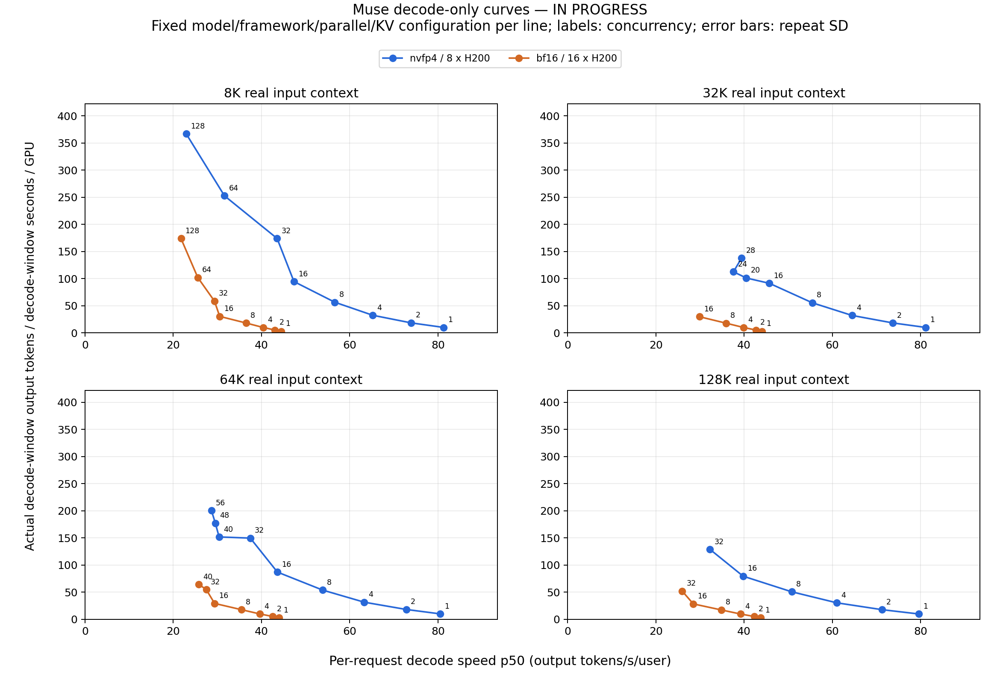
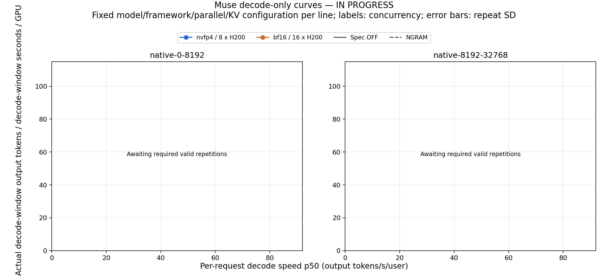

# Muse H200 Performance Data

Updated: 2026-11-05 02:07:55 UTC. Accepted decode points: 83; valid repetitions: 253.

[English code, data, methodology, and offline reproduction package](english/README.md)

[Download complete ZIP](english/muse_decode_h200_bundle.zip) · [Exact decode points](decode_points.csv) · [Individual repetitions](decode_rounds.csv) · [Prefill points](prefill_points.csv)

The BF16 baseline curves contain measured points for all four input lengths. BF16 coding and some high-concurrency repairs remain in progress. Failed attempts are excluded from valid points; no hardware-limit conclusion is inferred solely from stream-read errors.

The DeepInfer overlay is a digitized 64-SM100 external reference, not a local H200 benchmark.
