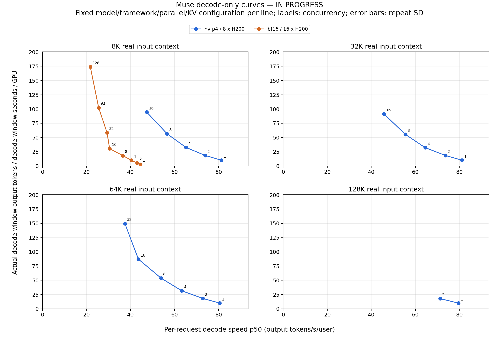
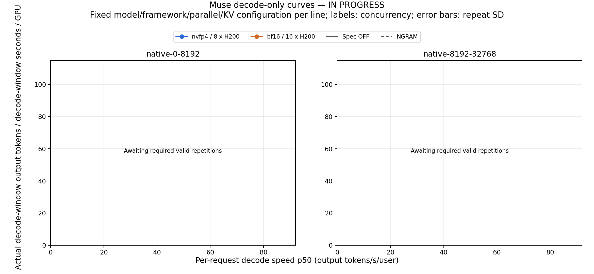
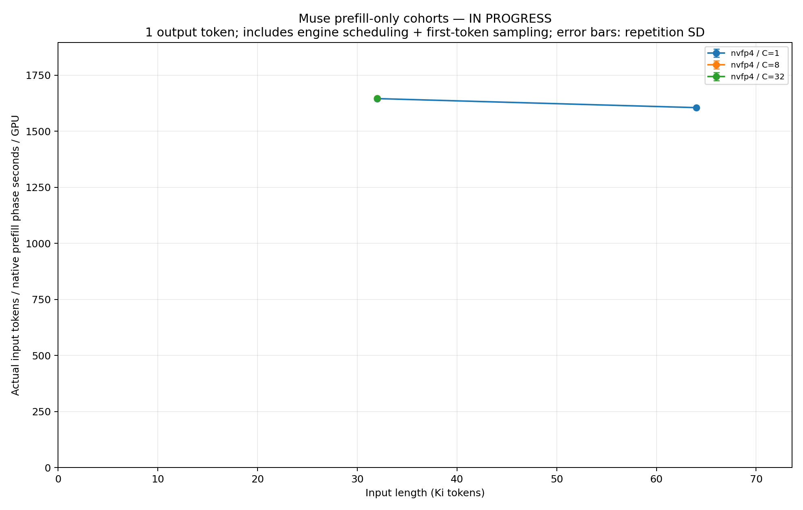
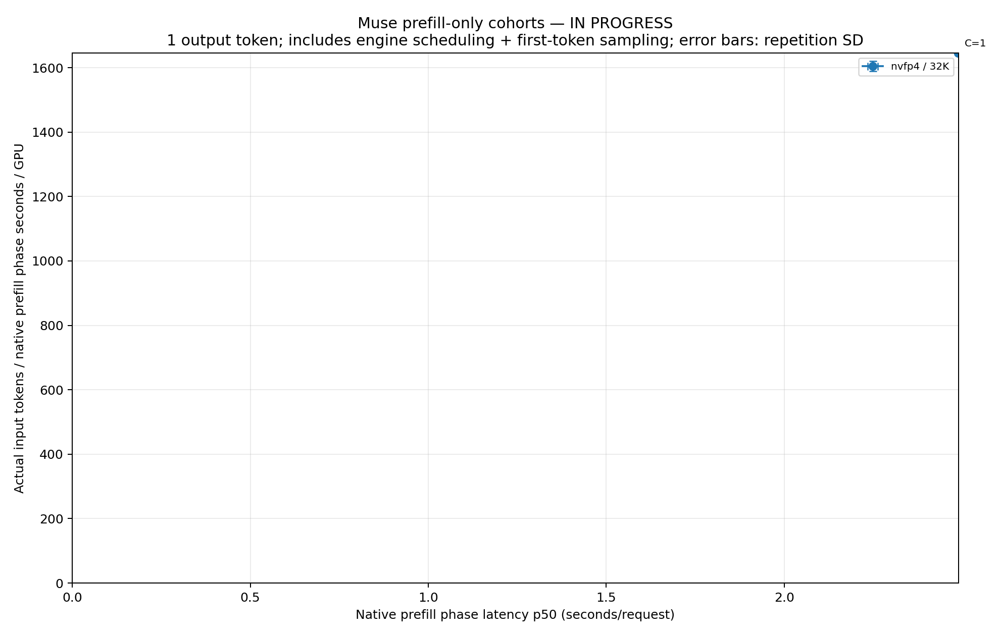

# Muse decode-only 测试

这是独立新测量，尚未完成；不复用之前包含 prefill 的服务曲线。

更新时间：2026-10-30 16:57:27 UTC

累计申请 20 个节点；完成 175 个有效重复、57 个满足重复要求的测点。

当前测试 allocation：运行 0 个节点、排队 6 个节点；不含对外 API 与其他项目。准备阶段失败的作业：3138, 3139, 3140, 3141。这些基础设施失败不计为模型性能结果，具体原因及替代作业见 progress.json。

## 调度实况

```
3158|PENDING|2|(Resources)
3157|PENDING|2|(None)
3156|PENDING|2|(None)
```

## 多组、多点矩阵

NVFP4/BF16 × 8K/32K/64K/128K，共 8 组基础曲线；每组目标并发 1、2、4、8、16、32、64、128、256。coding 的两个实际长度桶 × 两种精度 × 投机开关，另有 8 组曲线，各目标并发 1、2、4、8、16、32。

上限共 120 个独立配置点、364 次重复。实际遇到 KV、延迟或稳定性边界时保留失败记录并明确标注，不能把未测试点补成完成，也不宣称达到全硬件峰值。

逐点计划与完成次数：[decode_matrix.csv](decode_matrix.csv)。32K 已执行同一热模型实例的加密扫描；KV 回收触发的尝试不进入曲线。原始记录和每项作业最终状态见 progress.json。

## 定义

每批实际完成 prefill 并生成 1024 tokens。取所有请求都进入 decode 的共同区间，额外剔除每个请求首尾各 64 tokens；区间内不补入新请求。检查 native KV retraction 计数未增加。

每重复热身至少 60 秒有效 decode；正式累计至少 120 秒有效 decode 和 32 个成功请求。不同批次之间 prefill/refill/排空时间不计入分母。这是多个纯 decode 区间之和，并非连续 120 秒的闭环 serving 窗口。

横轴是区间内逐请求解码速度中位数；纵轴是区间内实际 native output token 增量之和 / 区间时长之和 / 物理 GPU 数。保留 reasoning、输出、逐 token 时间戳、完整原始请求、GPU 与后台遥测。

投机对照保持采样参数不变，使用 NGRAM 原生 target-only 验证路径；移除不受支持的 draft_probs rejection 路径。对照双方均固定 decode graph max batch 32，防止之前 8 GiB verify page-table 分配失败。

服务器接入/流式传输仍有开销，本图不声称是 CUDA kernel 的纯设备计时。硬件、模型、并行和上下文未与 DeepInfer 对齐，不直接作吞吐倍数比较。

配置与控制器：[测试代码](../../performance/muse_decode_20261029/README.md)。原始详细状态：[progress.json](progress.json)。





[全部 context 曲线叠加](decode_pareto_synthetic.png)；[coding 曲线叠加](decode_pareto_coding.png)。

## Prefill 独立测量

已完成 45 个有效重复、15 个三重复测点。

每请求实际 prefill 完整输入，只生成 1 token，不混入后续 decode 工作。分母取 native `forward_entry_time` 至 `prefill_finished_time` 的整批包络；分子为该批 native `prompt_tokens` 之和。保存客户端耗时，但不拿 TTFT 代替这个 native prefill 阶段计时。

该阶段计时包括 chunk 调度和首 token sampling，属于 engine 阶段 wall time，不宣称是独立 CUDA kernel 时间。每重复热身至少 60 秒，正式累计至少 120 秒及 32 个请求，三重复后画图，保留 GPU/后台遥测。




