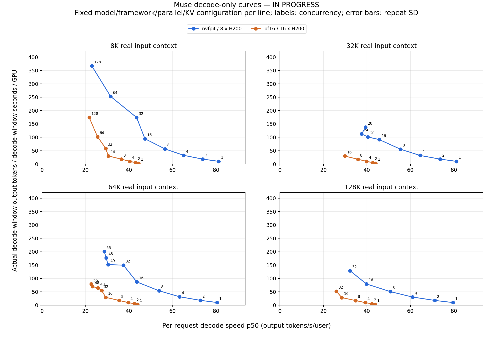
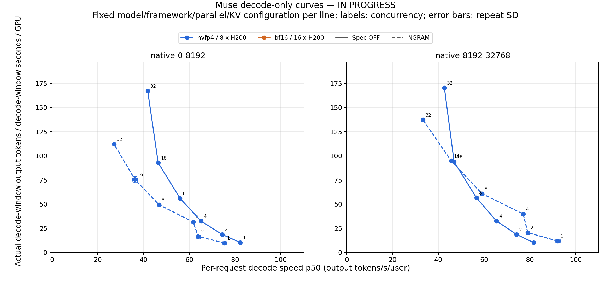

# Muse H200 Decode Performance: Code and Exact Plot Data

Snapshot generated: 2026-11-06 12:51:44 UTC. This package contains **83 accepted decode points**, **253 valid decode repetitions**, and **24 accepted prefill points**. Snapshot refresh time is not the time of a new GPU measurement. Work is still in progress; failed and unmeasured configurations are not successful points.

## Start here

- [Benchmark and plotting code](code/)
- [Exact plotted decode coordinates and error bars](data/decode_points.csv)
- [Individual decode repetitions](data/decode_rounds.csv)
- [Per-request decode speeds](data/decode_request_speeds.csv.gz)
- [Actual measured decode windows and token counts](data/decode_windows.csv.gz)
- [Prefill coordinates](data/prefill_points.csv) and [prefill repetitions](data/prefill_rounds.csv)
- [8K/1K TTFT P50 and P95](data/ttft_8k_points.csv)
- [SHA-256 file manifest](manifest.json)
- [Download the complete reproducibility ZIP](muse_decode_h200_bundle.zip)

## Figures





All figure labels and documentation in this snapshot are English. PNG, PDF, and SVG copies are in [figures](figures/).

## Reproduce the figures offline

After extracting the ZIP, run:

```bash
python -m venv .venv
source .venv/bin/activate
pip install -r code/requirements-plot.txt
python code/recompute_points.py --data data --out recomputed_decode_points.csv
python code/plot_from_csv.py --data data --out replotted
```

The first command reconstructs both coordinates and both error bars from the exported request speeds, measured windows, and repetition records, then checks every accepted point against `decode_points.csv`. The second command needs only the published CSVs. No model weights, Slurm access, private filesystem paths, or API keys are required to replot. Fonts and rendering-library versions can affect pixels; the numeric coordinates remain the same.

## Hardware and fixed configuration

| Configuration | Weights | Physical hardware | Parallelism | KV cache | Framework |
|---|---|---|---|---|---|
| Muse NVFP4 | NVFP4 / modelopt FP4, Marlin MoE | 8 H200 GPUs | TP8 / EP8 | FP8 e4m3 | SGLang |
| Muse BF16 | BF16 | 16 H200 GPUs | TP16 / EP16 | FP8 e4m3 | SGLang |

Pinned image: `lmsysorg/sglang@sha256:8cfc5a72cb296771f5f8a4a4688cb6d05685610a830cbb616fa4ab0eb7bb2b0a`.

The exact model revisions and per-file hashes are in [frozen_model_manifests.json](code/frozen_model_manifests.json). Input lengths are 8192, 32768, 65536, and 131072 tokens; output length is 1024 tokens. Baseline speculation and prefix caching are disabled. Sampling uses temperature 1, top-p 1, top-k -1, and ignore-EOS. Output counts include reasoning and final text. Baseline admission cap is 256. Static memory fractions are 0.90 for NVFP4 and 0.88 for BF16. These different GPU counts and parallel configurations prevent attributing all differences solely to weight precision.

The base concurrency grid is 1, 2, 4, 8, 16, 32, 64, 128, and 256. Dense follow-ups add intermediate loads. Coding workloads use two native input-length buckets and separately report speculation off versus native NGRAM verification. Paired coding controls use the same decode graph maximum batch size of 32; their profiles are separate from the baseline graph profile.

## What the decode axes mean

Each cohort contains exactly C simultaneous requests. Real prefill builds real KV. Each request discards its first and last 64 output tokens. The measured interval is the intersection during which all C requests remain decoding. No new request enters that interval. Prefill, refill gaps, and draining tails are excluded from the decode denominator. These are client-observed native decoding windows, not isolated CUDA-kernel timings and not continuous closed-loop serving throughput.

- **X:** median individual-request decode speed, pooled across valid repetitions, in output tokens/s/user.
- **Y:** actual native output-token increments in all measured windows / total measured-window seconds / physical GPU count.
- **X error bar:** sample SD of per-repetition median request speeds.
- **Y error bar:** sample SD of per-repetition actual throughput per GPU.

Y is never computed as concurrency multiplied by mean user speed. Each repetition requires at least 60 seconds of warmup decode, then at least 120 seconds of measured decode and 32 successful measured requests. At least three repetitions are required; NVFP4 8K C=4 and C=8 use five. Accepted points require valid requests, no observed KV retraction, and utilization/memory telemetry for all GPUs covering at least 80% of the measured windows. The underlying full text and full GPU traces stay in the original run artifacts; this package exports the numeric request speeds, timing windows, source-summary hashes, and acceptance flags needed to reconstruct the published axes.

High-concurrency failures are preserved. Some show KV retraction; 8K C=256 also has stream-read errors under investigation. A request error or missing full-resident interval is not, by itself, proof of a hardware KV limit. BF16 coding groups and high-concurrency repairs may still be pending. [decode_matrix.csv](data/decode_matrix.csv) distinguishes measured points from pending or unresolved upper loads.

## TTFT and prefill

TTFT is time from starting a native request to its first output token, including actual prefill and scheduling. Warmup requests are excluded. The TTFT table is pooled from measured requests in batch/cohort tests, not a new public-API latency test or a continuous serving experiment. The audit JSON and compressed request-level TTFT records are included in `data`.

Prefill runs generate one output token. Their denominator is the native engine interval from `forward_entry_time` to `prefill_finished_time` for the cohort; the numerator is actual native input tokens. This includes engine scheduling and first-token sampling and is separate from decode throughput.

## Run the measurement client

Start a dedicated compatible native SGLang endpoint with the pinned model, KV precision, prefix-cache and speculation settings. The client needs `/generate`, `/tokenize`, `/metrics`, `/server_info`, and `/flush_cache`. It does not use the public OpenAI-compatible relay.

```bash
pip install -r code/requirements-client.txt
python code/decode.py --base http://HOST:31420 \
  --output runs/nvfp4/spec-off/synthetic-8192 \
  --precision nvfp4 --gpus 8 --corpus code/coding_prompts.jsonl \
  --input-tokens 8192 --concurrency 1,2,4,8,16,32,64,128,256
```

Run [gpu.py](code/gpu.py) on every GPU node throughout measurement. For BF16, use `--precision bf16 --gpus 16`. Provisioning scripts in `code` capture the original Linux/Slurm/Docker/AWS-EFA environment: update absolute paths, account, partition, local NVMe paths, and networking for another cluster. The native client and offline plotting tools are independent of that scheduler setup. Model weights and container images are downloaded separately and are not part of the ZIP. Resource-retention behavior is controlled explicitly by the allocation policy; no artificial GPU busy load is generated.

## DeepInfer reference provenance

The green external-reference curve is digitized from the pinned official DeepInfer PNG. It is **not a local H200 measurement**. It uses DeepSeek V4.1 Flash, 64 SM100 GPUs, requests per DP rank, and a plotted mean step rate multiplied by an assumed acceptance factor of 3.25. Muse uses H200, global cohort concurrency, actual native output increments, and per-request P50. No hardware conversion or speedup ratio is claimed.

[Digitized reference values](data/reference/deepinfer_digitized_points.csv), original pixel/source metadata, and the upstream Apache-2.0 license are included. The ongoing H200 DeepInfer dependency probe has not produced a model-throughput curve.
