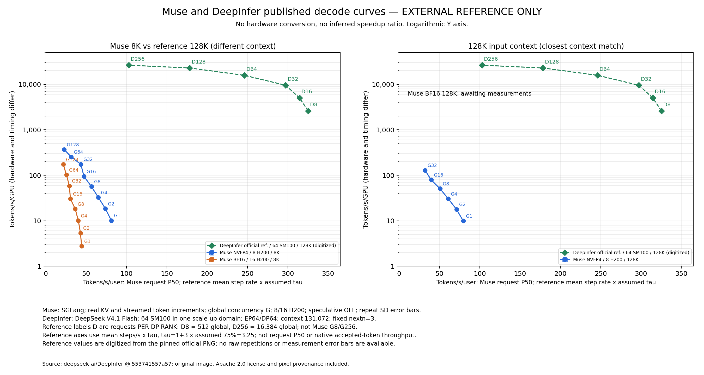
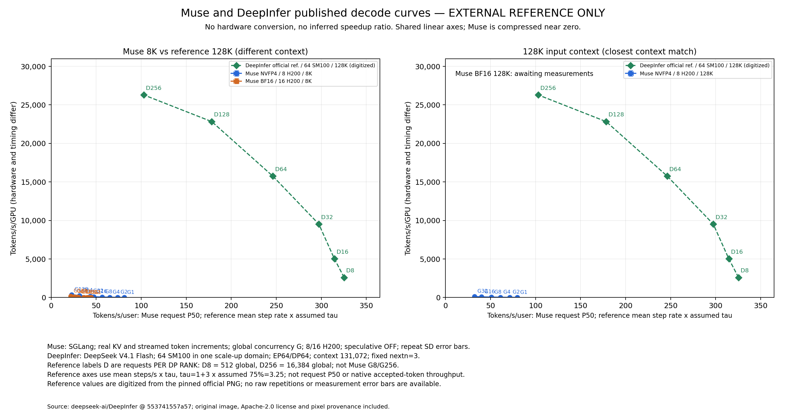

# DeepInfer 外部参考曲线

这是官方 PNG 的数字化参考值，不是我们本地运行 DeepInfer 得到的结果，也不是官方原始测量 JSON。
两轴按原图刻度独立换算，保存 marker 像素坐标、标定点、文件 SHA-256 和固定 Git commit；数字化约有 1 像素误差，不伪造重复测试或误差棒。

| 条件 | Muse 本地曲线 | DeepInfer 官方参考 |
|---|---|---|
| 模型 | Muse Spark Open | DeepSeek V4.1 Flash |
| 硬件 | NVFP4 8×H200；BF16 16×H200 | 64×SM100，同一 scale-up 域 |
| 并行 | TP8/EP8 或 TP16/EP16 | EP64/DP64，CP1 |
| 上下文 | 8K/32K/64K/128K | 131,072 |
| 并发标注 | 整个副本全局请求数 G | 每 DP rank 请求数 D；全局为 D×64 |
| 横轴 | 真实流式 Decode 区间内逐请求速度 P50 | 平均 step/s × τ |
| 纵轴 | native 输出 token 增量÷区间时长÷物理 GPU 数 | 平均 step/s × 每 rank 请求数 × τ÷CP |
| 投机 | 基础曲线关闭；coding 单列 NGRAM 对照 | fixed nextn=3，设定接受率75%，τ=3.25 |
| 测量 | 客户端选取所有请求都在 decode 的区间 | engine steady-step benchmark；排除 LB flush 区间 |

不能把同名并发标注视为相同负载，也不能用每 GPU 归一代替硬件、拓扑和统计口径对齐。图中未做 SM100→H200 换算。
128K 面板只对齐了输入长度；仍不能据图计算框架效率或模型速度倍数。

若要比较本地服务体验，应在相同 H200 数量、全局并发、输入输出长度、采样/缓存/投机策略下，用同一流式闭环客户端测两种模型。
这只能比较该部署条件下的模型与框架组合，不能归因为框架本身。官方发布列出的 NVIDIA 支持是 SM100，并未声明 H200 支持，因此不能假定 DeepInfer 可直接在本集群复现。
若要严格重现官方图，需要其支持的硬件与规模、模型和 engine-step 测量协议。

- [readme](https://github.com/deepseek-ai/DeepInfer/blob/553741557a57df44a46fb3ab72b6aafeaf945337/README.md)
- [plot_code](https://github.com/deepseek-ai/DeepInfer/blob/553741557a57df44a46fb3ab72b6aafeaf945337/examples/sweep/plot_pareto.py)
- [benchmark_code](https://github.com/deepseek-ai/DeepInfer/blob/553741557a57df44a46fb3ab72b6aafeaf945337/examples/benchmark.py)
- [original_figure](https://github.com/deepseek-ai/DeepInfer/blob/553741557a57df44a46fb3ab72b6aafeaf945337/doc/images/decode_pareto.png)
